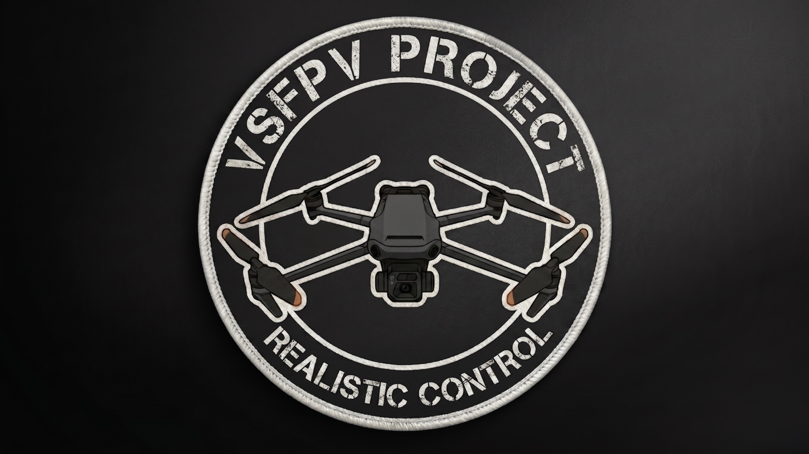

# VSFPV PROJECT



First-person drones for Scrap Mechanic. Put the transmitter on the ground, place a drone within 15 m of it and press E on the transmitter. You fly the drone from its own camera while your character stays at the transmitter.

Steam Workshop: https://steamcommunity.com/sharedfiles/filedetails/?id=3803749604

## Drones

- DJI FPV - acro quad, flies like a real FPV drone and is the hardest one to land
- Mavic 3 Cine - camera drone that levels itself, with 7x zoom and Return to Home
- PG-7 Kamikaze - carries an RPG-7 warhead, so each one flies once

The controls for the drone you are flying are listed on screen. 9 hides the list, and it stays hidden for that type of drone. That choice and the pitch setting from 7 are saved in `pilot_settings.json` in the mod folder.

## Controls

| Key | DJI FPV, PG-7 | Mavic |
|---|---|---|
| W / S | throttle | forward / back |
| A / D | yaw | left / right |
| Mouse | pitch and roll | turn, camera tilt |
| LMB / RMB | throttle up / down | up / down |
| Wheel | throttle 1% per notch | zoom |
| 1 2 3 | | Cine / Normal / Sport |
| 4 | | Return to Home |
| 5 | hide the HUD | hide the HUD |
| 6 | | horizon lock |
| 7 | invert pitch | |
| 8 | night vision (PG-7) | |
| 9 | hide the controls list | hide the controls list |
| 0 | let go of the drone, take the next one in range | same |
| Space / E | leave the transmitter | same |

Return to Home needs a home point first. Land the Mavic where you want it and press 4, the HUD shows HOME SET. After that 4 in the air flies it back and lands it there, and the home point is gone once it lands. Pressing 4 during the return gives you control back, three quick presses clear the home point. With no home point set, 4 in the air does nothing.

With only one drone in range, 0 just lets go of it. Leave the transmitter and sit back down to take it again.

## Installing from GitHub

Clone the repo into your mods folder, `%APPDATA%\Axolot Games\Scrap Mechanic\User\User_<your id>\Mods`:

```
git clone https://github.com/rimoshka926/vsfpv-project.git "VSFPV PROJECT"
```

Don't enable it together with the Workshop version, both add the same parts.

The game builds a `Cache` folder from the meshes on first load and keeps using it, so if you edit an `.fbx`, delete `Cache` before starting the game again.

Most of the tuning (speeds, rates, the warhead) is in `Scripts/fpv_config.lua`. Flight is in `fpv_drone_flight.lua`, the warhead in `fpv_drone_warhead.lua`, and the transmitter with its HUD in the `fpv_controller` files.

Tested on Scrap Mechanic 1.0.6.889.

## Multiplayer

Works. Players only take damage with the [Universal PVP](https://steamcommunity.com/sharedfiles/filedetails/?id=2858553544) mod, in vanilla Creative they have no health.

## Known issues

- Sometimes in multiplayer an exploded PG-7 stays in the world instead of disappearing
- After a crash that doesn't destroy the drone, the motor sound can keep going

If you hit a bug, the newest file in `steamapps\common\Scrap Mechanic\Logs` is the game log, and it helps to attach it. `CFG.DEBUG_LOG` in `fpv_config.lua` turns on more logging, e.g. `{ det = true }` for detonations. The channel names are in the comment above it.

## Credits

Models from Sketchfab, CC BY 4.0, modified to work in the game:

- ["RC Controller"](https://sketchfab.com/3d-models/rc-controller-b604ff776f9a44ce89e2e2a3c2eae9a5) by gorzi
- ["FPV Drone"](https://sketchfab.com/3d-models/fpv-drone-0294037f390a4351926c11caf3e5c43e) by Jeyhun1985
- ["DJI Mavic 3"](https://sketchfab.com/3d-models/dji-mavic-3-c5a5abae1dea468ab73b1bdc7d616fa6) by llirikslon
- ["DJI FPV"](https://sketchfab.com/3d-models/dji-fpv-7c5346e50ffb4e8c9ac12cb0847be39a) by polyman Studio

## License

MIT, see [LICENSE](LICENSE). The models and their textures stay under [CC BY 4.0](https://creativecommons.org/licenses/by/4.0/), see `Credits.txt`.
